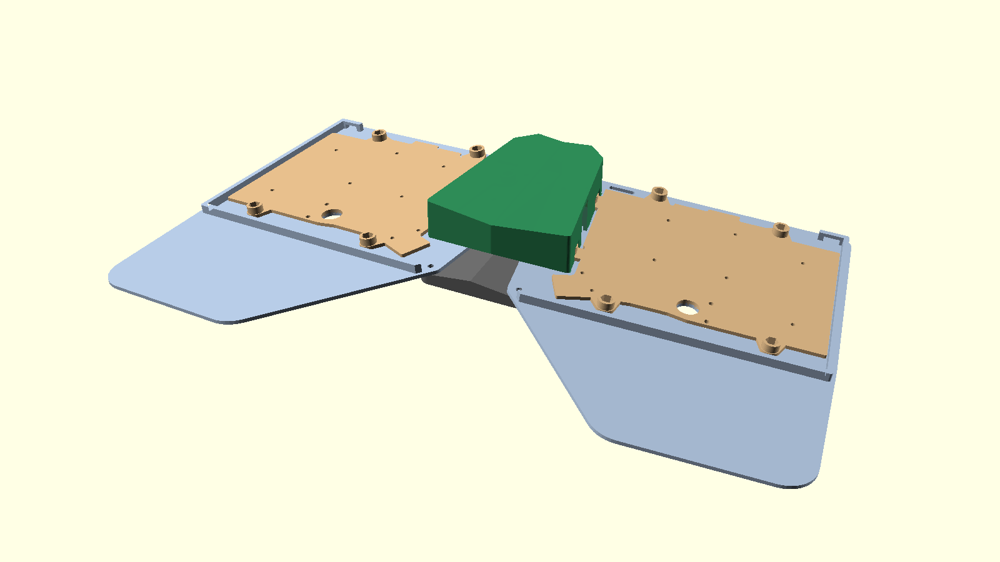
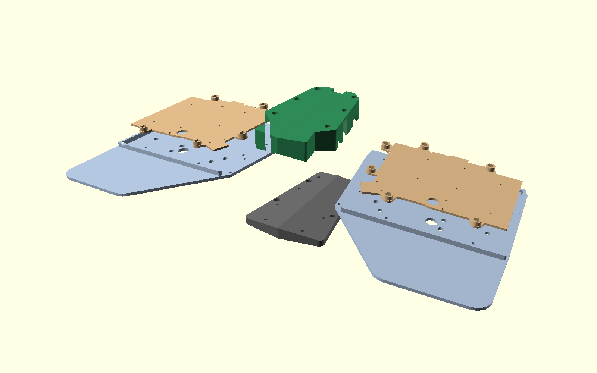

# Keyball61 ラップボード

[Keyball61](https://shirogane-lab.net/)（左右ともトラックボール搭載）を膝上で使うための
3Dプリント製ラップボード。極力2mm厚の平面で構成し、キーボードは付属の
アクリル底板の代わりにプレートへ純正ネジで直接固定する。




## 構成 (6パーツ + M3×8なべ×24 + M3ナット×18 + M3熱圧入インサート(外径4.5×長さ5)×6)

| パーツ | 印刷 | 説明 |
|---|---|---|
| `stl/v4_plate_left/right.stl` | ベタ置き | **一体平面プレート**(2mm): キーボード搭載部+パームレスト+中央張り出し。たわみ抑えのL字リブ(3×5mm)付き |
| `stl/v4_bottom_plate_left/right.stl` | ベタ置き | **ボトムプレート**(2mm): キーボードを純正M2ネジで固定する板(付属アクリル底板の代わり・外形も同じ)。KB外形の外に耳6箇所を出し、左右プレートの上に重ねてネジ止めする |
| `stl/v4_center_spine.stl` | ベタ置き | **切妻テント形の中実スパイン**: 上面=左右7°の切妻(テント角を作る)、底面=フラットで浮く。厚さ5.4〜11mm |
| `stl/v4_top_cover.stl` | 天面を伏せて | **上部カバー**: キーボードの間・スパインの真上に載る底の開いた箱。Touch ID基板(85×31)とTRSケーブル(L型プラグごと)を収める。左右プレートを橋渡しして中央のたわみも抑える |

- スプレイ10°・テンティング7°(スパインの形状が作る)・左右間隔は `v4_corner_x = 10`(奥端ではプレート同士が中心線で突き合わせ)
- 全パーツ**サポートゼロ**
- **セルフタップなし**(ボルト+ナット、上部カバーのみ熱圧入インサート)、M3は**M3×8なべ1種類**:
  - ジョイント(×6): プレート内縁がスパインに12mm重なり、上からM3×8なべ×3/側→
    スパイン底面の六角ポケットのナット(回り止め・天井は45°テーパーで印刷品質確保)
  - ボトムプレート(×12): 左右プレートの下からM3×8なべ×6/側→ボトムプレートの耳の
    **上開き六角井戸**(上から落としたナットが井戸の床に引き付けられ、六角の壁が回り止めになる)。
    ネジ頭は左右プレート下面に2.4mm出るので、接地ライン(外側エッジ)から離した北・南・内側にだけ置く
  - 上部カバー(×6): 左右プレートの下からM3×8なべ×3/側→カバーの柱の下端の**M3熱圧入インサート**(外径4.5×長さ5, 下穴Φ4.0×深さ6)。
    柱はKB外形〜縫い目の帯(蝶番部)に立ち、中段の柱は天板まで延長
- キーボード部は左右プレート+ボトムプレートの**2層4mm積層**。キーボードはボトムプレートごと
  着脱できる(左右プレートのM2/ボールケースネジ頭の逃げ穴から、キーボード単体の着脱も可能)
- たわみ抑えリブ: ジェルパッド80×95mm領域(パーム外側の隅)の北縁+外側エッジの
  L字(パッドの位置決めストッパー兼用)。スパイン接続帯の横リブは上部カバーが帯を跨いで
  締結するので廃止
- 上部カバー: 天面は水平(z≈42)、壁の下端は左右プレート上面に沿う。西壁(左右)に
  **TRSプラグの切欠き**(幅14・ジャック軸高さ11mm想定)、北壁にTouch IDの**USB-C窓**(天板の縁ごと切り欠き、下辺は45°の尖り=伏せ印刷でブリッジなし)、
  北西角はキーボードのUSBプラグ逃げの面取り。Touch ID基板は天板の裏に両面テープで貼る
  (四隅にL字の位置決め枠)。ボタンのフレキはUSB-C窓から出す
- ケーブルまとめ: 外側後方の角に**ベルトループ**(上面のバー下にバンドを通す。
  貫通穴だとバンドが足に当たるため)、親指M2穴の真北に3×15貫通スロット
- 注意: 平面構造なのでプレートは接地ライン(外側エッジ)以外浮く。膝上での使用前提
- **要現物確認**: TRRSジャックの軸高さ(`v4tc_jack_h`=ボトムプレート上面から11mm想定)と
  L型プラグの太さ(`v4tc_plug_d`=11)。カバーの高さ・切欠きはこの2つから決まる。
  ボトムプレート南側の耳はボールケースの張り出し(sx40..105)を避けて置いてある

## 組立

1. スパイン底面の六角ポケット×6にM3ナットを差し込む
2. プレートをスパインの屋根フランジに重ね、上からM3×8なべ×3/側で締結
3. キーボードをボトムプレートに載せ、下から純正ネジで固定(アクリル底板と同じ要領)。
   ボールケースも従来通り
4. ボトムプレートの耳の井戸×6/側にナットを落とし、左右プレートに載せて下からM3×8なべで締結
5. 上部カバーの柱の下端×6にM3熱圧入インサートをはんだごてで埋め(柱の端面と面一かわずかに奥まで)、
   Touch ID基板を天板裏に貼る。
   TRSケーブル(L型)を左右のジャックに挿してカバーを被せ、下からM3×8なべ×3/側で締結
6. ジェルパッドをリブに突き当てて貼る

## Touch IDモジュール取付 (任意)

Touch IDボタン(キーボード側に置く)を固定する小物2点。

| パーツ | 印刷 | 説明 |
|---|---|---|
| `stl/touchid_plate.stl` | 底面をベッドに置く | **取付プレート**(15.6×16.0×1.05mm): 板厚0.9mm+天面中央にφ3×0.15mmのボス(モジュールの当たり面)。南辺にケーブル逃げの切欠き |
| `stl/touchid_foot.stl` | ベタ置き | **十字フット**(15.1×14.4×2.0mm): プレート裏の2mmスペーサ。プレートに接着する |

- 固定は**超低頭ネジ×4**。頭(φ2.72実測)がプレート裏に露出する構成なので、
  通し穴は「軸φ1.8が通り、かつ頭が座る」φ2.5にしてある。印刷で穴が細く出る前提の
  寸法で、頭が抜けるようなら `touchid_hole_d` を下げる
- **フットが十字なのはネジ頭を逃げるため**。単純な帯だと短辺6mmで倒れるので直交
  バーを足して支持スパンを 6.0 → 14.4mm に広げた。バー幅を決めているのはネジ穴
  ではなく裏に露出する頭で、穴中心から
  `touchid_head_d/2 + touchid_foot_head_clr` = 2.0mm を空けている
- 一体で出力しようとすると、天面を伏せれば中央ボス(0.15mm)だけが1層目になって
  プレート全面が宙に浮き、フット側を下にすればプレート四隅(ネジ座面)が
  無支持の張り出しになる。**2部品に分けて接着するのが正解**
- プレート天面のボスは0.15mmしかないので**積層0.15mm以下**で印刷すること

寸法は `scad/touchid/touchid_params.scad` に集約してある。

## ビルド

```sh
make            # 全STL生成 (要 OpenSCAD: brew install --cask openscad)
make v4         # ラップボード本体のみ
make touchid    # Touch ID取付部品のみ
make check      # 設計検証 (v4は要 pip install trimesh numpy rtree networkx)
make images     # ドキュメント画像の再生成
```

パラメータは `scad/params.scad`(共通)と `scad/v4/v4_params.scad`。
キーボード外形は公式アクリルDXFから `scripts/extract_outline.py` で生成した実寸
(`scad/keyball61_outline.scad`, ポイント単位 0.353407mm/unit)。

`make check` は2本の検証を回す。設計変更のたびに必ず実行すること。

- `scripts/verify_v4.py` (`make check-v4`): 単一ボディ/平面性/ネジ軸の素通し/
  ナット位置の空洞/ネジの掛かり代/ネジ頭の逃げと接地/印刷オーバーハング/部品間干渉/
  Touch ID基板・TRSプラグの空間
- `scripts/verify_touchid.py` (`make check-touchid`): ネジ穴が公称径で貫通しているか/
  ネジ頭の座面幅/フットがネジ頭を逃げているか/フットがプレート外形からはみ出して
  いないか/ベタ置きできる平面か。依存なし(標準ライブラリのみ)

`scad/touchid/` は本体(`scad/v4/`)とは独立していて、`scad/params.scad` の
`$fn` だけを共有する。

## 履歴

- v1(可動キャリッジ式)・v2(固定式の楔+ブリッジ+ブレース)・v3(中空モジュール5分割)は
  git履歴を参照。v4は前作ラップボードの平面構造方式を採用したもの
